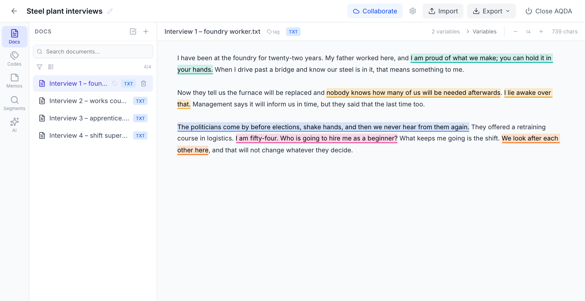

# AQDA — Augmented Qualitative Data Analysis

**A free, open-source tool for qualitative coding, with optional AI assistance that runs on your own computer.**

AQDA runs as a local web app in your browser. Your projects stay on your computer, and no cloud
subscription is needed. Its AI tools use [Ollama](https://ollama.com) on your own machine; they
send passages elsewhere only if you deliberately connect AQDA to an Ollama server on another
computer.


https://github.com/user-attachments/assets/fdbc8052-2ea4-4d6e-8c7e-6b4e7b1798e4


## Guides

- [Your first project](https://github.com/tseidl/aqda/blob/main/docs/first-project.md) —
  import documents, code, organize codes, write memos, export. Start here.
- [AI tools](https://github.com/tseidl/aqda/blob/main/docs/ai-tools.md) — setting up Ollama and
  using the six AI tools.
- [Working together](https://github.com/tseidl/aqda/blob/main/docs/collaboration.md) — sharing
  a project through Google Drive, Dropbox, or another shared folder.
- [Letting language models suggest codes](https://github.com/tseidl/aqda/blob/main/docs/model-runs.md)
  — advanced and optional; most projects never need it.

---

## What AQDA Does

- **Import** text (`.txt`), Word (`.docx`, formatting is dropped) and PDF documents, images
  (JPG, PNG, GIF, WebP), audio (MP3, WAV, M4A) with optional local transcription, and
  spreadsheets (`.csv`, `.tsv`, `.xlsx`) with one document per row. Images can be viewed but
  not coded.
- **Code** by selecting a passage and picking a code, or creating one on the spot. Click a
  coded passage to see its codes or remove one.
- **Build a codebook** of hierarchical codes with colors and definitions. Drag and drop to
  reorder, merge two codes that mean the same, and restore deleted codes.
- **Coding fields** (optional): answer a few questions each time you apply a code, for example
  whether the speaker agrees.
- **Memos** for the project, a document, a code, or a single passage, with `@` references to
  codes and other memos.
- **Document variables and tags** such as author, date, or source, which AQDA can read from
  filenames on import.
- **Several coders**: each coding records who made it, and you can show or hide each coder's
  codings.
- **Segments browser**: every coded segment across documents, filtered by code or coder.
- **Export** to REFI-QDA for MAXQDA, ATLAS.ti, and NVivo, and to CSV and JSON.



### AI Assistance (Optional)

AQDA uses [Ollama](https://ollama.com) to run AI models locally. With Ollama on your own
computer (the default), no internet connection is needed and nothing is sent to any server.
If you point AQDA at an Ollama server on another machine, the AI features send passages to
that machine.

- **Topic Search** — find passages that match a topic or theme you describe.
- **Code Suggest** — find uncoded passages that might belong to a code; **Apply** or
  **Dismiss** each.
- **Consistency Check** — flag coded segments that stand out from the other segments of the
  same code, as a prompt to re-read them.
- **Hierarchy Suggest** — get suggestions for grouping your codes into parent categories.
- **Define Code** — draft a definition from a code's coded passages.
- **Summarize Theme** — a summary of at most 300 words of what a code's passages say.

The tools question your coding rather than do it for you; the researcher always has the final
word. Documents you list under **Exclude documents…** in the AI panel, such as interview
guides, are ignored by every AI feature.

---

## Getting Started

### What You Need

- **Python 3.10 or newer**
- **pipx** (installs Python apps in isolated environments)
- **Chrome, Firefox, or Brave** — Safari has known issues with large file imports and downloads
- **Ollama** (optional, for AI features) — [ollama.com/download](https://ollama.com/download)

### Install

Open a terminal and run:

```bash
pipx install aqda
```

<details>
<summary><strong>Don't have Python or pipx?</strong></summary>

**Mac:**
```bash
# Install Homebrew (skip if you already have it)
/bin/bash -c "$(curl -fsSL https://raw.githubusercontent.com/Homebrew/install/HEAD/install.sh)"
```
After Homebrew installs, it prints commands to add it to your PATH — copy and run those lines, then:
```bash
brew install python pipx
pipx ensurepath
```
Close and reopen Terminal, then install AQDA.

**Windows:**

Download Python from [python.org](https://www.python.org/downloads/) — **check "Add python.exe to PATH"** during installation. Then:
```bash
pip install pipx
pipx ensurepath
```
Close and reopen Command Prompt, then install AQDA.
</details>

<details>
<summary><strong>Getting "command not found" after install?</strong></summary>

Run `pipx ensurepath`, then **close and reopen your terminal**. This adds pipx's install directory to your PATH.
</details>

### Start and Stop

```bash
aqda
```

This opens your browser at `http://127.0.0.1:8765`. To stop, click **Close AQDA** in the app,
or press `Ctrl+C` once in the terminal. Closing only the browser tab leaves AQDA running, which
is harmless; reopen `http://127.0.0.1:8765` to return.

New to AQDA? [Your first project](https://github.com/tseidl/aqda/blob/main/docs/first-project.md)
walks you through it.

### AI Features (Optional)

1. [Download and install Ollama](https://ollama.com/download)
2. Open a terminal and pull the models:
   ```bash
   ollama pull nomic-embed-text   # for similarity search
   ollama pull qwen3.5:9b         # for analysis and definitions
   ```
3. In AQDA, go to **Settings** and select your models under "Embedding Model" and "LLM Model"
4. Open the **AI panel** (sparkle icon in the left sidebar)

More in [AI tools](https://github.com/tseidl/aqda/blob/main/docs/ai-tools.md).

### Audio Transcription (Optional)

To transcribe audio files locally using Whisper:

```bash
pipx inject aqda "aqda[audio]"
```

Then import an audio file (MP3, WAV, M4A) and click the transcribe button.

### Updating and Uninstalling

```bash
pipx upgrade aqda
```

```bash
pipx uninstall aqda
```

Uninstalling removes the app but keeps your data in `~/.aqda/`. To remove everything, also
delete that folder.

---

## Your Data

AQDA saves every change as you work; there is no save button. All your projects live in one
private working database, `~/.aqda/aqda.db`. You never need to open or move this file.
On Windows, `~/.aqda/` is the folder `C:\Users\<name>\.aqda`.

**Do not put the live `aqda.db` in Google Drive, Dropbox, OneDrive, or a network folder.** To
work with others through such a folder, use AQDA's collaboration feature (below).

- **Automatic backups** — AQDA keeps seven verified daily backups in `~/.aqda/backups/`. It
  makes an extra backup before updating the database format, before merging codes, and before
  replacing a project with a collaborator's version (the ten newest collaboration backups are
  kept; adjustable in Settings).
- **Restoring a backup** — close AQDA, keep the current `aqda.db` as an extra copy, and copy
  the chosen backup into its place as `aqda.db`.
- **Moving or archiving a project** — **Export → Save a copy to send (.aqda)** gives a
  standalone copy; **Import Project** on the start page opens it.
- **Deleted projects and codes** go to a trash and can be restored; codes come back together
  with their child codes and coded segments.
- **Deleting a document is permanent.** Its coded segments are removed. Memos linked to it are
  kept, each with a note naming the deleted document.

---

## Working Together

Put a folder for the project in Google Drive, Dropbox, OneDrive, your university cloud, or
another synced location. In AQDA, open the project, click **Collaborate**, and choose that
folder. Your colleague adds the same folder under **Settings → Collaboration** and opens the
project from **Shared projects available**. Each of you should set a name in Settings so that
codings show who made them.

AQDA works on a local copy and publishes complete snapshots to the shared folder after a short
delay; you never save manually. Incoming changes appear automatically, after AQDA has made and
verified a full backup.

AQDA does not merge two independently edited versions. If two people work at the same time, or
one computer was offline, AQDA keeps both: your project, and a **Collaborator reference**
project to compare it with. You then choose which version everyone continues from.
[Working together](https://github.com/tseidl/aqda/blob/main/docs/collaboration.md) explains
the steps.

---

## Export Formats

| Format | Use case |
|--------|----------|
| `.aqda` | Save a standalone copy to send or archive — full AQDA round-trip import/export |
| `.qdpx` | REFI-QDA text exchange — import into MAXQDA, ATLAS.ti, NVivo |
| `.qdc` | Codebook XML — share code hierarchies between projects |
| `.csv` | Coded segments as a table — for further analysis in R, Excel, etc. |
| Statements `.csv` | One row per coded segment with its document variables, coding fields, coder, and model run — for example to build discourse networks in R |
| `.json` | Analysis data and document variables — for R, Python, or custom processing |

QDPX exports text and audio transcripts as text sources, with document variables and with
memos linked to their codes and passages. Original audio and image media are not included; use
`.aqda` when an exact AQDA round-trip is needed.

---

## Letting a Language Model Suggest Codes (Advanced)

Most projects never need this. AQDA's own AI tools do not code for you. If you want to
develop codes inductively with the help of language models, a small program on your computer
can let one or several models read your documents and suggest codes with the passages they
rest on. This is a shortcut, not a substitute for reading: each suggestion is marked as the
model's and sits in the text, where you accept or remove it. The program works with local
Ollama models and with online services; with an online service, the text of your documents is
sent to that service. See
[Letting language models suggest codes](https://github.com/tseidl/aqda/blob/main/docs/model-runs.md).

---

## License

MIT

## Acknowledgments

Built with substantial assistance from [Claude Code](https://claude.ai/code) (Claude Opus 4.6 by [Anthropic](https://anthropic.com)). Architecture, backend, frontend, and AI integration were developed collaboratively through human-AI pair programming.

Inspired by [QualCoder](https://github.com/ccbogel/QualCoder) and the qualitative research community's need for modern, accessible, AI-augmented analysis tools.
