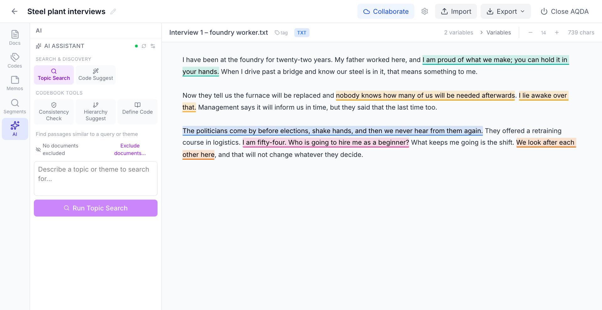
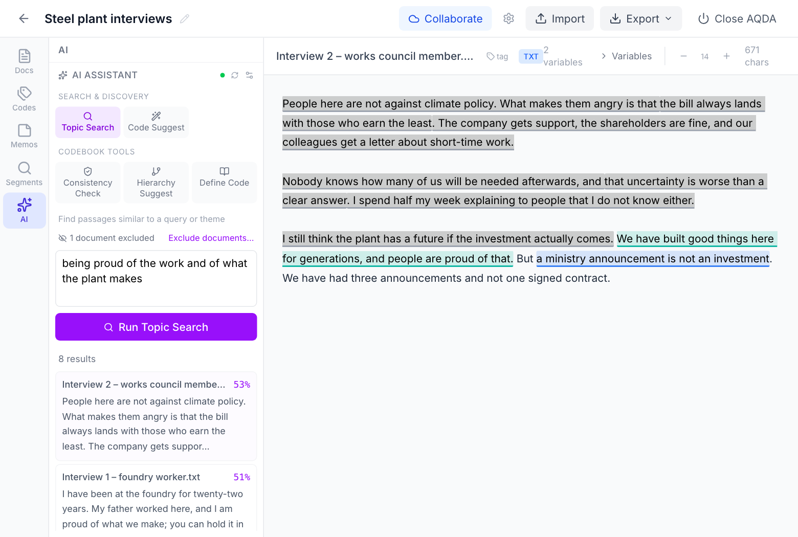
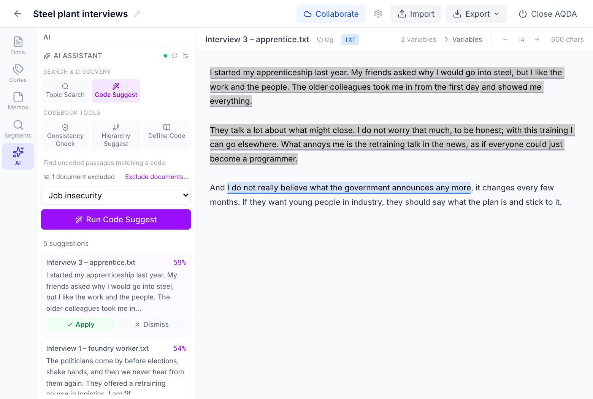
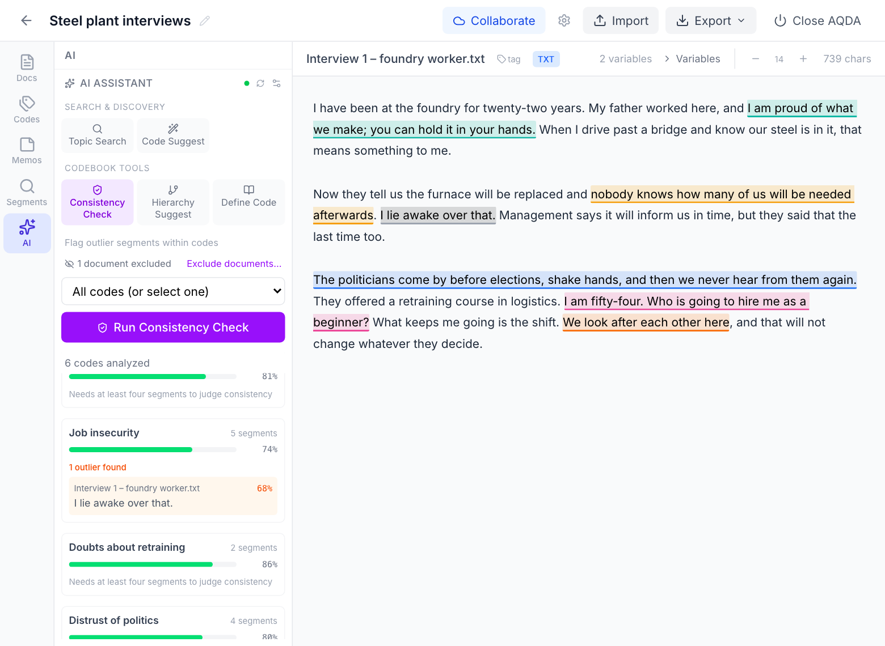
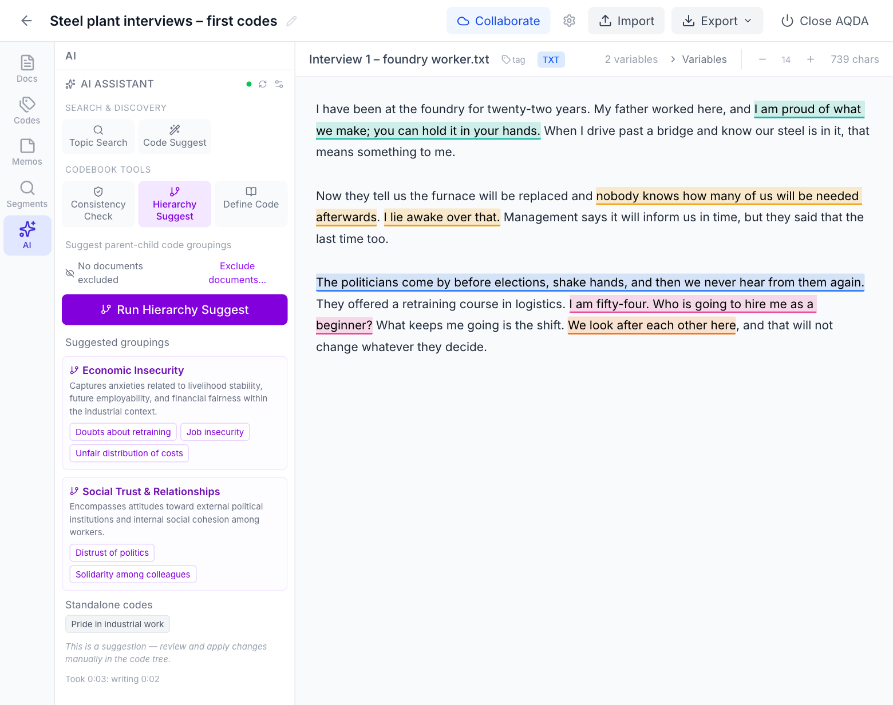
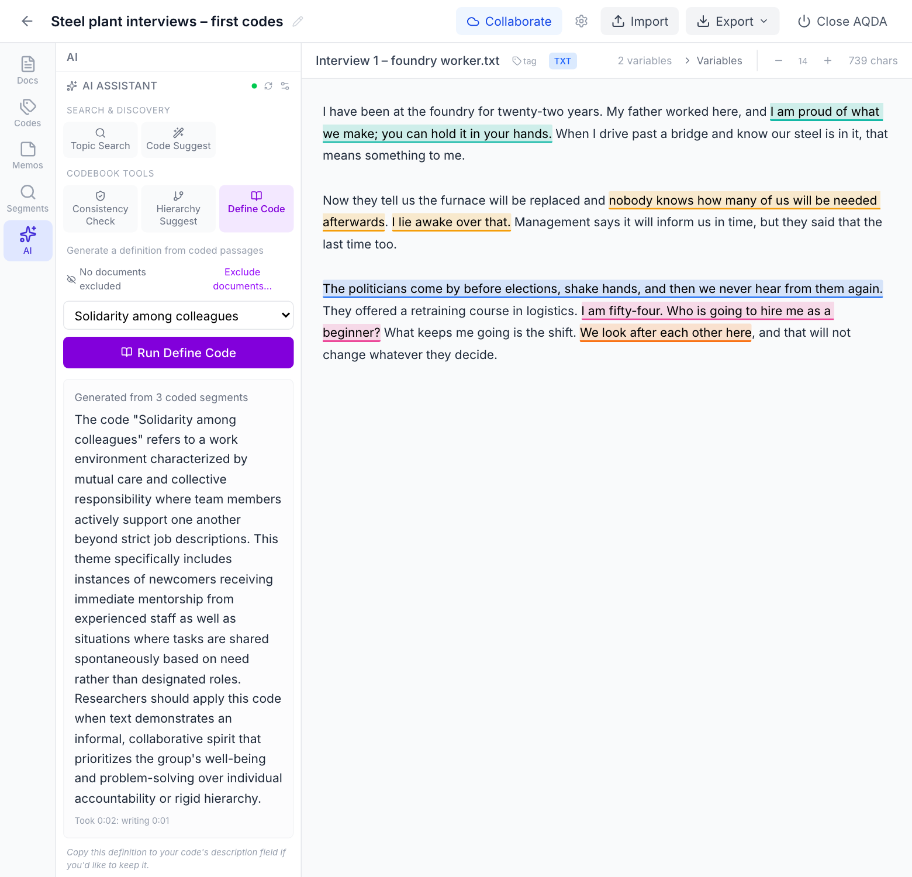
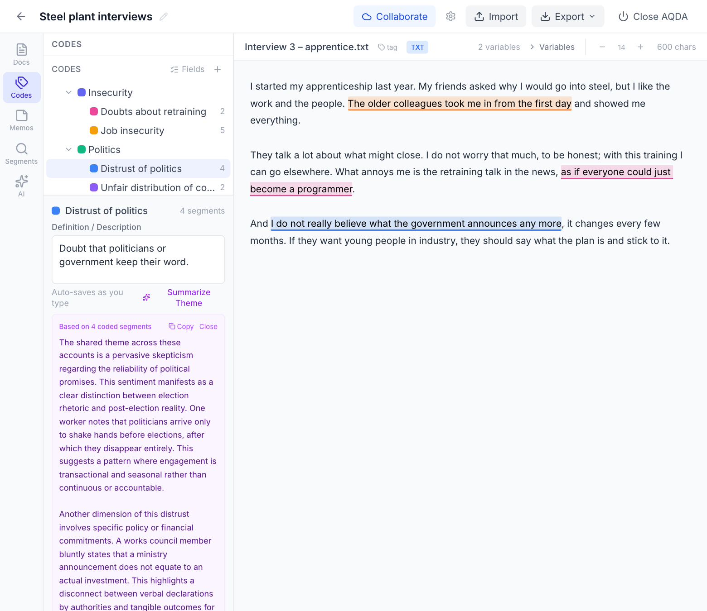
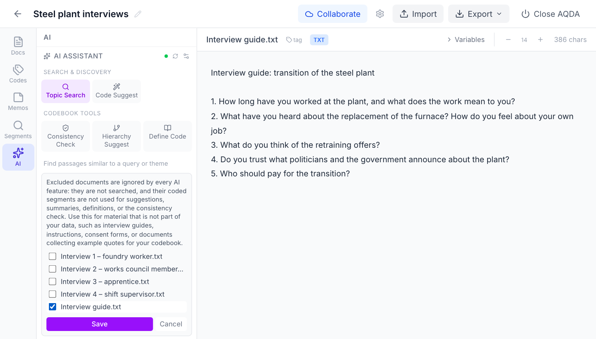

# AI tools

AQDA's AI tools are optional. They use [Ollama](https://ollama.com) to run models locally on
your computer. With Ollama on your own computer (the default), no internet connection is
needed and nothing is sent to any server. If you point AQDA at an Ollama server on another
machine, the AI features send passages to that machine.

The tools are designed as a methodological interlocutor: they question your coding rather than
generate it. The researcher always has the final word.

## Setting up

AQDA uses two types of models. You need one of each.

| Model type | What it does | Used by | Recommended model |
|-----------|-------------|---------|-------------------|
| **Embedding model** | Converts text into numerical representations so similar passages can be found | Topic Search, Code Suggest, Consistency Check | `nomic-embed-text` (fast, 274 MB) |
| **Language model** | Reads text and writes an answer (definitions, groupings, summaries) | Hierarchy Suggest, Define Code, Summarize Theme | `qwen3.5:9b` (6 GB) |

1. [Download and install Ollama](https://ollama.com/download).
2. Open a terminal and pull the models:
   ```bash
   ollama pull nomic-embed-text   # for similarity search
   ollama pull qwen3.5:9b         # for analysis and definitions
   ```
3. In AQDA, go to **Settings** and select your models under "Embedding Model" and "LLM Model".
4. Open the **AI panel** (sparkle icon in the left sidebar).

## The tools



| Tool | What it does |
|------|--------------|
| **Topic Search** | Find passages across your documents that match a topic or theme you describe |
| **Code Suggest** | Given a code, find uncoded passages that might belong to it (from its definition and coded examples); review each and **Apply** or **Dismiss** it |
| **Consistency Check** | Flag coded segments whose meaning stands out from the other segments of the same code — a prompt to re-read them, not a measure of agreement |
| **Hierarchy Suggest** | After inductive coding, get suggestions for grouping your codes into parent categories |
| **Define Code** | Applied a code many times but not written a definition yet? Generate one from the actual coded passages |
| **Summarize Theme** | For one code, a summary of at most 300 words of what its coded passages say. The button is below the code's definition in the **Codes** tab. |

The first five are in the AI panel. When you click on a result, AQDA jumps to the passage in
the document and highlights it, so you can see the context and decide whether to code it.

Topic Search and Code Suggest cover text, PDF, and transcribed audio.

The pictures below show each tool on a small project of invented interviews, with the two
recommended models.

### Topic Search

Describe a topic in your own words and run the search. Each result is a passage with a
similarity score; clicking one opens its document with the passage highlighted in grey.



### Code Suggest

Choose a code and run the tool. **Apply** codes the suggested passage with that code;
**Dismiss** removes the suggestion from the list. Here the first suggestion for *Job
insecurity* is a respondent who says they do not worry much: suggestions are passages to read,
not codings.



### Consistency Check

For each code, the bar shows how similar its segments are on average; a code needs at least
four segments to be judged. Here one of the five *Job insecurity* segments is flagged: "I lie
awake over that." says little without the sentence before it.



### Hierarchy Suggest

The tool proposes parent categories for your codes and lists the codes it would leave on their
own. Nothing changes in the code tree; adopt what convinces you by hand. The example is a
project whose six codes are not grouped yet.



### Define Code

Choose a code; the model writes a definition from the passages coded with it. To keep it, copy
the text into the code's definition in the **Codes** tab.



### Summarize Theme

In the **Codes** tab, click a code and then **Summarize Theme** below its definition. The
summary appears underneath as plain text; scroll to read all of it, use **Copy**, or **Close**
it. Where it points to a passage, it quotes a few words or names the document.



## Excluding documents

Use **Exclude documents…** in the AI panel for material that is not part of your data, such as
interview guides, instructions, or documents collecting example quotes for your codebook.
Excluded documents are ignored by every AI feature: they are not searched, and their coded
segments are not used for suggestions, summaries, definitions, or the consistency check.



## How much text the model sees

Summaries, definitions, and hierarchy suggestions send the model only as many passages as fit
into its context window, judged by a deliberately generous estimate of their length. When a
code has more, AQDA sends a selection spread over all of its passages and says how many it
sent (for example, 34 of 120). Answers that reach AQDA's length limit are marked as possibly
incomplete.

## Letting a model code

AQDA's own AI tools do not code for you. If you want language models to read your documents
and suggest codes, see [Letting language models suggest codes](model-runs.md), an advanced and
optional way of working.
