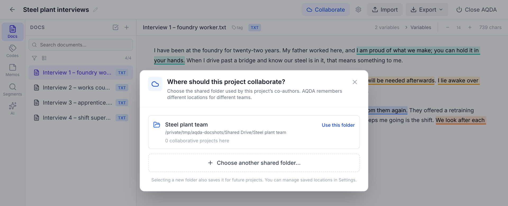
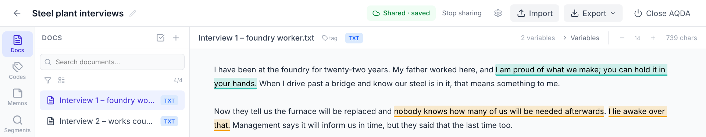
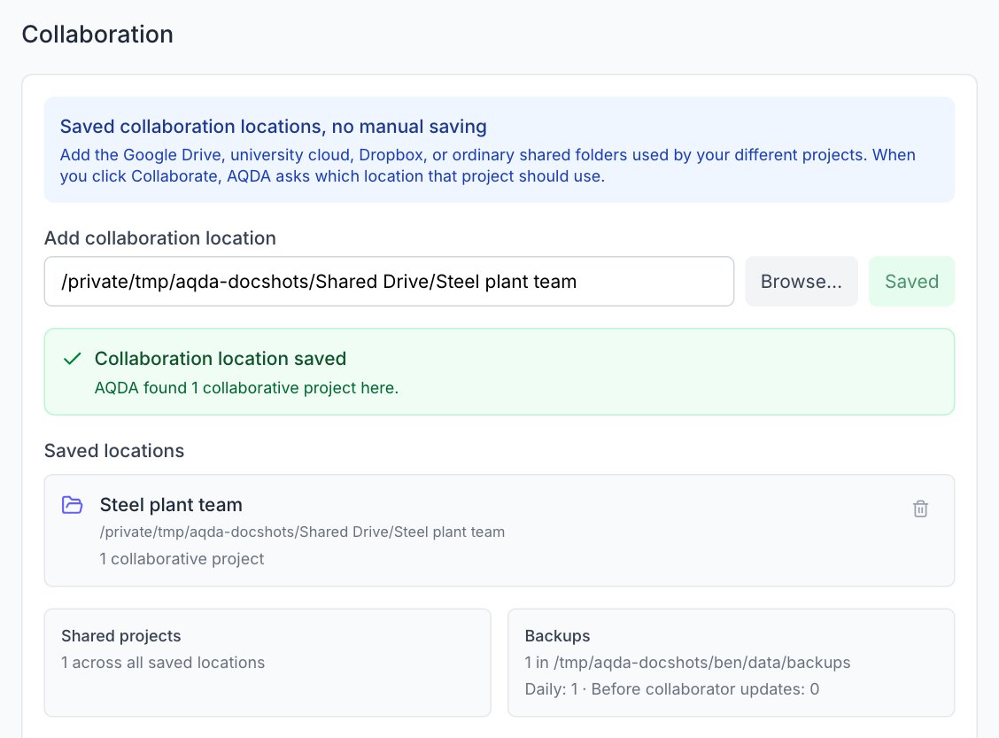
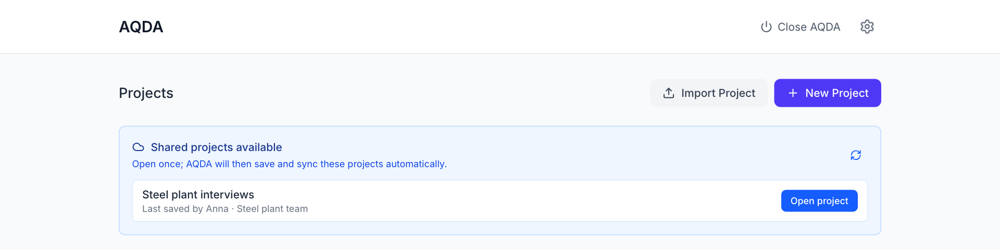
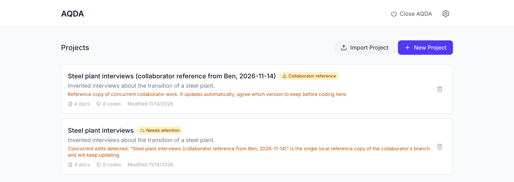
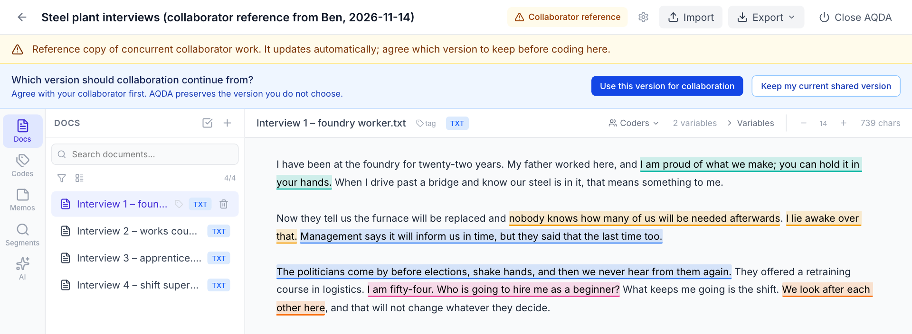
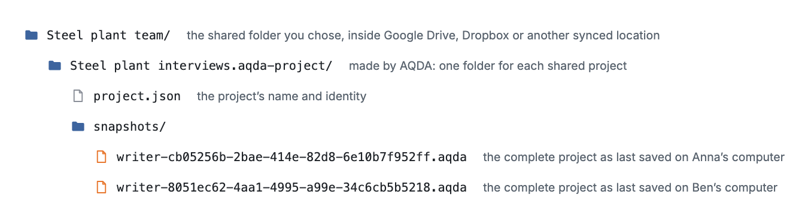

# Working together

Collaboration in AQDA is designed to feel like opening the same document from a shared folder:
Google Drive, Dropbox, OneDrive, your university cloud, or another synced location. AQDA
quietly works on a safe local copy and syncs complete, closed snapshots in the background. The
local copy lives with all your other projects in AQDA's own database; it is not another file
you have to open or manage. You never need to save manually.

Do not put AQDA's live database (`~/.aqda/aqda.db`) itself into a synced folder. The shared
folder described here gives you the same convenience without the risk of a cloud service
syncing a database while it is in use.

## Before you start

- Each researcher sets a name under **Settings → Coder Identity**. Each coding records who made
  it, so collaborators show up as distinct coders in the Segments browser and in exports.
- Update AQDA together. A project that uses model runs or coding fields is not
  replaced by a version from a collaborator whose AQDA is too old to keep them; AQDA says that
  the collaborator needs to update. Collaborators still on 0.7.0 or older cannot be warned by
  their own AQDA, so update together before using model runs or coding fields in a shared
  project.

## Setting up a shared project

1. Make a folder for that project or team inside Google Drive, Dropbox, OneDrive, your
   university cloud, or another synced location.
2. Open the project in AQDA and click **Collaborate**.
3. Choose a previously saved location, or click **Choose another shared folder…** and select
   the folder from step 1.

   

   The project's header then shows **Shared · saved** instead of **Collaborate**.

   
4. On the other researcher's computer, add that same folder under
   **Settings → Collaboration**.

   
5. The project appears on the start page under **Shared projects available**; click
   **Open project** once.

   

AQDA remembers several collaboration locations. A project with one co-author can use a Google
Drive folder, another a university-cloud folder, and a third Dropbox; clicking **Collaborate**
lets you choose the location for each project. Each project connects to one location at a
time.

## Day to day

Both researchers open the project normally from AQDA's project list. Changes are saved locally
at once, and complete snapshots are published to the shared folder after a short delay.
Incoming changes appear automatically. Before replacing local project data, AQDA creates and
verifies a full backup.

**Stopping AQDA.** Use the **Close AQDA** button, or press `Ctrl+C` once in the terminal. Both
perform a final sync. Closing only the browser tab leaves AQDA running, which is harmless;
reopen `http://127.0.0.1:8765` to return. If the computer stops unexpectedly, the local copy
is kept and syncs on the next launch.

## When two versions diverge

If two people work at the same time, or one computer was offline, AQDA detects the two
histories and does not let either person's work overwrite the other's. The original shared
project remains your version. For each other version, AQDA creates exactly one clearly named
**Collaborator reference** project and keeps updating that same reference as new work arrives;
it does not make another copy or shared folder on every sync.

Treat the collaborator reference as a copy for comparison, not a new place to code. To resolve
it:

1. Compare the two projects and agree which version everyone will continue from.
2. On a computer where the current shared project is the chosen version, open the collaborator
   reference and click **Keep my current shared version**. The reference moves to the trash.
3. On a computer where the collaborator reference is the chosen version, open it and click
   **Use this version for collaboration**. AQDA creates a full backup, switches the shared
   project, and keeps the previous local version as a clearly named local archive.

This is an explicit choice rather than an automatic merge, because coding decisions from two
versions cannot safely be combined by guesswork. AQDA does not merge two independently edited
versions into one.

## What is in the shared folder

The shared folder contains one `.aqda-project` folder for each shared project, with a complete
snapshot file for each participating computer. AQDA manages these; do not rename or edit them.
**Stop sharing** removes this computer's snapshot while keeping its local project intact.
Starting collaboration again reuses the same project folder.

*Schematic of the shared folder after two researchers, Anna and Ben, have opened the project.*

## Working alone

For one-person work, nothing of this is needed: create a project, work normally, and close
AQDA. Everything is saved automatically.
