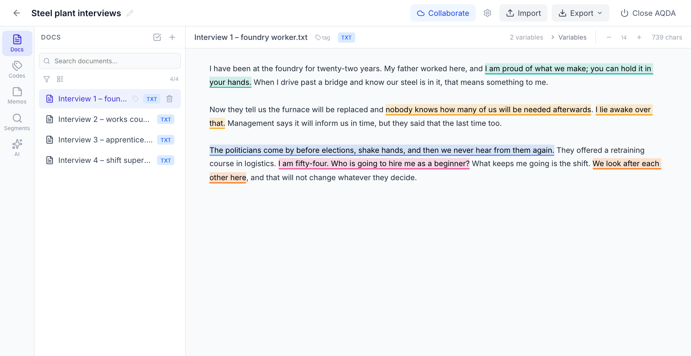
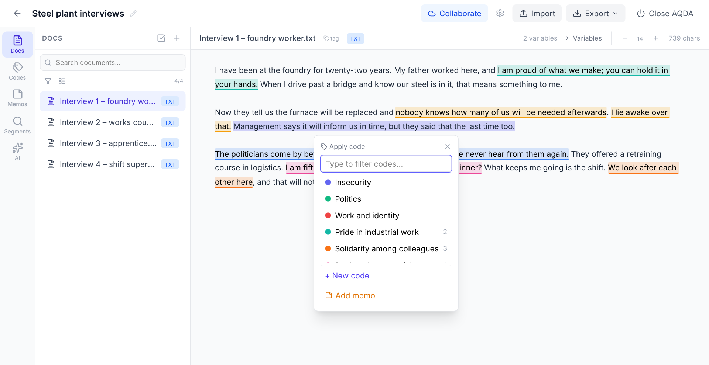
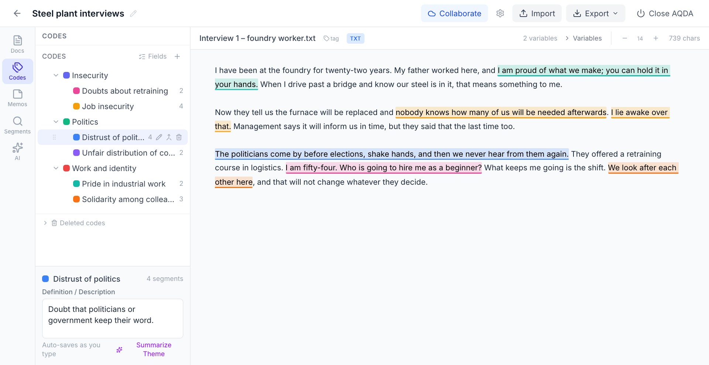
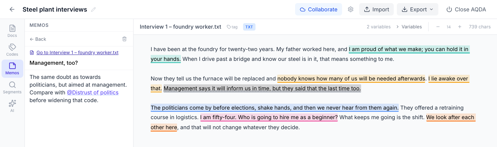
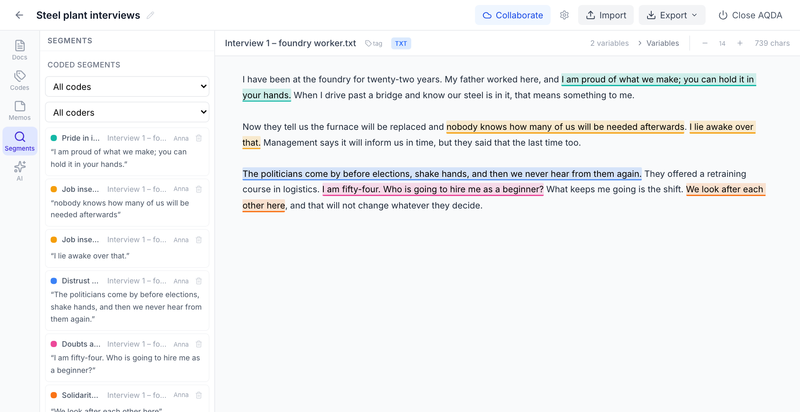

# Your first project

This page walks through a first project: adding documents, coding them, organizing the codes,
and exporting the result. It assumes AQDA is installed and running; see the
[README](../README.md) for installation.

AQDA saves every change as you work. There is no save button.



## 1. Create a project and add documents

On the start page, click **New Project**. In the **Docs** tab, click **+** (or **Import** at the
top) to add files:

- text (`.txt`), Word (`.docx`; formatting is dropped), and PDF documents
- images (JPG, PNG, GIF, WebP), which can be viewed but not coded
- audio (MP3, WAV, M4A). To transcribe it locally, install the audio extension (see the
  README), open the audio document, and click the transcribe button.
- a spreadsheet (`.csv`, `.tsv`, or `.xlsx`), which becomes one document per row. Choose the
  column with the text to code; the other columns become document variables.

**Document variables and tags.** Open **Variables** in a document's header to add metadata
such as author, date, or source. A short tag (for example `INT`) is shown next to the document
in the sidebar.

**Variables from filenames.** If your files follow a naming convention, AQDA can read
variables from the filename on import. In **Settings → Filename Variable Parsing**, set a
pattern with named groups. For files like `2025-03-10_guardian_from-border-crackdown.txt`:

```
(?P<date>\d{4}-\d{2}-\d{2})_(?P<source>[^_]+)_(?P<title>.+)
```

This extracts `date`, `source`, and `title` as document variables when you import. For
documents imported earlier, use **Parse variables from filenames** in the filter panel of the
**Docs** tab.

## 2. Code

Select a passage with the mouse. A small window opens: pick a code, type to filter the list,
or create a new code on the spot. **Add memo** attaches a note to the passage instead.



Click a coded passage to see which codes it carries or to remove one.

**Your name as coder.** Set your name in **Settings → Coder Identity** before you start. Each
coding records who made it, so that colleagues show up as distinct coders in the Segments
browser and in exports. Several coders can apply the same code to the same passage.
**Coders** in the document toolbar shows or hides each coder's codings, for example to code a
document before looking at a colleague's version.

**Coding fields (optional).** You can have AQDA ask a few questions each time you apply a
code, for example whether the speaker agrees (yes / no) or which person or organization makes
the statement. Answers can be yes / no, a whole number, or text with suggestions from earlier
answers. Define the fields under **Codes → Fields**. One passage can carry the same code
several times with different answers, for example for two speakers. The Statements export has
one column per field.

## 3. Organize your codes

The **Codes** tab shows the code tree.



- **Hierarchy.** Drag codes onto each other to build parent and child codes, or drag them to
  reorder.
- **Definitions.** Click a code and write its definition below the tree.
- **Merge.** Fold one code into another when they mean the same. Its coded segments, memos,
  and child codes move over; exact duplicates are dropped; a differing definition is kept as a
  memo. A merge cannot be undone inside AQDA, so AQDA makes a backup first.
- **Delete.** A deleted code goes to *Deleted codes* at the bottom of the list. It can be
  restored together with its child codes and coded segments.

## 4. Write memos

The **Memos** tab holds your analytical notes for the project, a document, or a code. A memo
attached to a passage (with **Add memo** while coding) lets you jump back to that passage.
In the document, a passage with a memo has a dotted underline; click it to open the memo.
Type `@` in a memo to refer to a code or another memo (choose from the list with the arrow keys
and Enter, or with the mouse); click the reference to jump to it.



## 5. Read across documents

The **Segments** tab lists every coded passage, filtered by code or coder. Click one to jump
to it in its document, or delete it directly from the list.



## 6. Export

**Export** (top right) offers:

- **Codings (.csv)** and **Statements (.csv)** for analysis in R, Excel, or elsewhere. The
  Statements table has one row per coded segment with its document variables, coding fields,
  and coder.
- **REFI-QDA (.qdpx)** to continue in MAXQDA, ATLAS.ti, or NVivo, and **Codebook (.qdc)** for
  the code tree alone.
- **Analysis Data (.json)** for R, Python, or custom processing.
- **Save a copy to send (.aqda)** to archive the project or move it to another computer, where
  **Import Project** on the start page opens it.

## Next steps

- [AI tools](ai-tools.md): let a local model search your documents and question your coding.
- [Working together](collaboration.md): share the project with colleagues through a shared
  folder.
