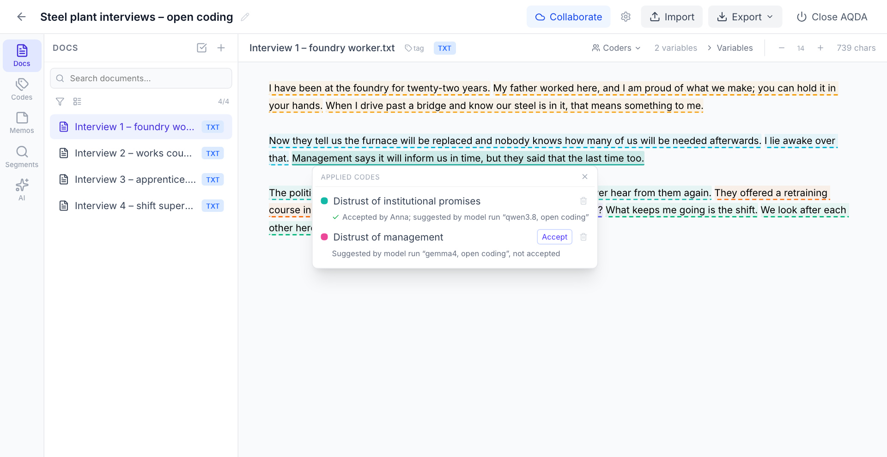
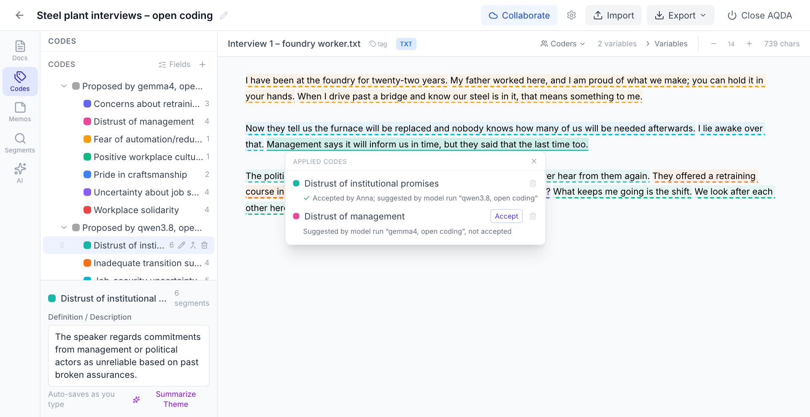
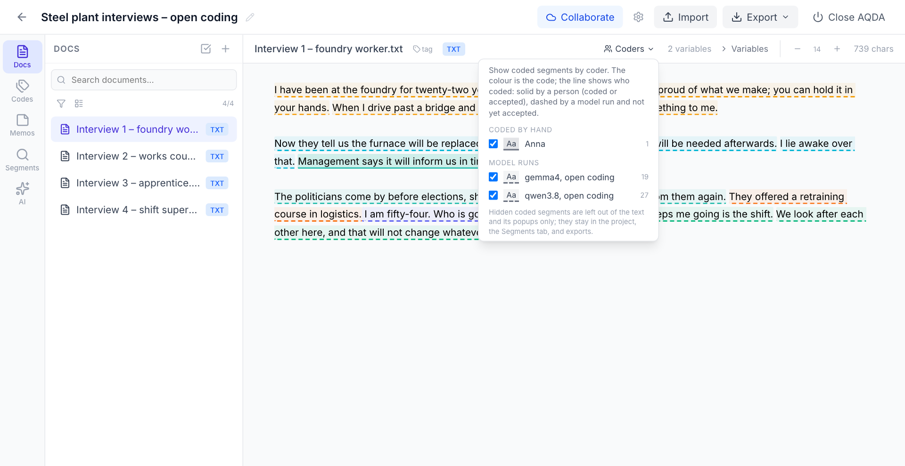
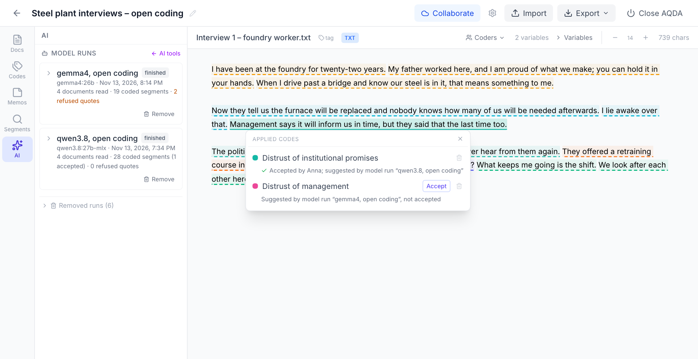

# Letting language models suggest codes

This is an advanced, optional way of working. AQDA's own AI tools never code for you. A *model
run* lets a language model read your documents and suggest codes with the passages they rest
on. You read along in the text and decide what holds.

**What it is for.** Developing codes inductively with the help of language models. One model,
or several side by side, read the documents and propose codes with the passages they rest on.
This is a shortcut to a first set of codes, not a substitute for reading: every suggestion
sits in the text, where you check it against the material, accept or remove it, and rework
the proposed codes into a codebook of your own. You can start with no codes at all, or with
a first draft that the models apply and extend.

**What it is not for.** Classifying thousands of texts with a finished scheme. For that, a
script in R or Python that loops over a table is simpler and easier to validate.

## How it works

The model never touches AQDA. A small program on your computer goes between the two:

1. It asks AQDA for a document's text and the current codes.
2. It sends both, with your instructions, to a language model: a local one through
   [Ollama](https://ollama.com), or an online service.
3. The model answers with quotes from the document and a code for each.
4. The program hands the quotes to AQDA. AQDA looks each quote up in the document itself. A
   quote that is not there word for word, or is there more than once without enough context
   to tell which, is refused and listed with the reason. Nothing is placed approximately.
   (Small typographic differences, such as curly instead of straight quotation marks, are
   tolerated.)

Everything one such pass produces is recorded as a *model run*: the model, your instructions,
the codebook as it was, the documents read, and the refused quotes.

## Three ways to use it

| | What you start with | What the model does |
|---|---|---|
| **Open coding** | No codes, or very few | Proposes codes with definitions and the passages they rest on |
| **Several models** | The same project | Each model gets its own run. A model does not see what the others proposed, so you can compare what they come up with. |
| **Draft codebook** | Your codes with definitions | Applies your codes, and proposes further ones if you allow it |

In all three, codes that a model proposes are collected under one code named after its run
("Proposed by …"), separate from your own codes until you adopt them.

## Step by step

### 1. Prepare

- AQDA is running and your project has documents.
- Note the project number: the number after `/project/` in AQDA's address bar.
- Get the example program. It is a single file that needs only Python 3.10 or newer:
  download [`model_coding.py`](https://github.com/tseidl/aqda/blob/main/aqda/examples/model_coding.py).
- Write your instructions into a text file, for example `instructions.txt`. For open coding:

  ```text
  You are helping a researcher get a first sense of the themes in interviews with industrial
  workers about the transition of their plant. There is no finished codebook.

  Read the interview and mark the passages that say something substantial about how the
  speaker experiences the transition. Give each passage a code: a short name for the theme
  (two to five words) with a one-sentence definition. Reuse a code from the list whenever it
  fits; propose a new one only for a theme the list does not cover. Aim for a small number
  of codes that would also apply to other interviews.

  Quote each passage word for word, as a whole sentence or clause.
  ```

  The program adds the list of codes (names and definitions) and the technical rules for the
  answer itself, so the instructions only need to say what you want.

### 2. Look before you run

`--dry-run` lists the documents and prints the full prompt for the first one. No model is
called and nothing changes:

```bash
python3 model_coding.py --project 3 \
    --base-url http://localhost:11434/v1 --model qwen3.8:27b \
    --label "qwen3.8, open coding" --instructions instructions.txt \
    --allow-new-codes --dry-run
```

### 3. Run

Start with a few documents (`--limit 5`). With a local model through Ollama, your documents
stay on your computer:

```bash
python3 model_coding.py --project 3 \
    --base-url http://localhost:11434/v1 --model qwen3.8:27b \
    --label "qwen3.8, open coding" --instructions instructions.txt \
    --allow-new-codes --limit 5
```

The program reports each document as it goes:

```text
Started run “qwen3.8, open coding” on 4 documents.
Reasoning: none. The model answers directly (--reasoning low, medium or high lets it think first, which is slower).
[1/4] Interview 1 – foundry worker.txt: 7 placed, 0 refused
[2/4] Interview 2 – works council member.txt: 4 placed, 0 refused
...
Done: 4 documents recorded, 20 codings, 0 quotes refused, ...
```

**Reasoning is off by default.** Many current models can "think" before they answer. For
this task that mostly costs time, and local models sometimes think for many minutes without
answering at all. The program therefore asks for an answer without reasoning and says so
when it starts. `--reasoning low`, `medium` or `high` lets the model think first.

For a second model, run the program again with another `--model` and another `--label`.
From the second document on, a model is shown the codes it proposed itself so far, so that
it reuses them instead of inventing a new name each time. It is never shown what another
run proposed.

| Option | Meaning |
|--------|---------|
| `--label` | The name of the run as AQDA shows it |
| `--allow-new-codes` | Let the model propose codes. Needed for open coding; without it, only your codes are applied. |
| `--limit N` | Read at most N documents |
| `--dry-run` | Show what would be sent; call no model, change nothing |
| `--aqda` | AQDA's address, if it is not `http://127.0.0.1:8765` |
| `--reasoning` | `none` (default), `low`, `medium`, `high`; `default` sends no setting and leaves it to the service |
| `--api-key-env NAME` | The environment variable that holds the key of an online service |
| `--no-json-mode`, `--no-temperature` | Leave out two request settings that some services refuse (see below) |

Documents you excluded from AI features (**AI → Exclude documents…**) are skipped.

### 4. Review in AQDA

What a model coded has a **dashed underline**; what a person coded or accepted is solid.
Click a dashed passage to see the code and the run that suggested it.



- **Accept** makes the coding yours: one coding, in your name, with a solid underline. It
  remembers which run suggested it and stays even if you later remove the run. You can then
  change it like any coding of your own.
- The **bin** removes a single coding you do not agree with.
- Code a passage yourself as usual wherever the models missed something.

In the **Codes** tab, each run's proposals sit under its own "Proposed by …" code. Click a
code to read its definition. Edit the name or definition, drag the code into your own
codebook, **merge** codes that mean the same (also across runs), or delete what you do not
need. A proposed code that you have moved into your codebook is shown to every later run.



**Coders** in the document toolbar shows or hides each run, for example to look at one model
at a time.



**AI → Model runs** lists the project's runs (the entry appears once a project has one). Open
a run to see its instructions and, per document, any refused quotes with the reason.
**Remove** takes away every coding of the run that you did not accept; a removed run can be
restored. The codes it proposed stay until you delete them.



A workable routine: let one or two models code a handful of documents, read those documents
with their suggestions, accept and remove, tidy and merge the proposed codes into a codebook
of your own, remove what is left of the runs, and start again with the improved codebook.

## Which model?

Proposing themes is easier for a model than applying a detailed coding scheme reliably, and
a mid-sized local model can do it, more or less. What you get are suggestions to read
against the text, not a coding to rely on.

Our test: two models that run on a well-equipped laptop, `qwen3.8:27b` and `gemma4:26b`,
read four short invented interviews without a codebook.

- **Without reasoning (the default),** each needed about 30 to 40 seconds for all four
  interviews. One sent 20 quotes and AQDA placed all of them; the other sent 21, of which
  AQDA placed 19 and refused 2. Each proposed about seven codes, and the two sets overlapped
  heavily (job uncertainty, distrust of promises, pride in the work, solidarity, retraining).
- **With reasoning,** the first model took about six minutes and coded nearly every sentence
  (28 quotes, all placed). The second got lost in its reasoning and gave no answer within ten
  minutes.
- **Models differ.** A third model, `muse-glimmer:30b`, returned nothing at all without
  reasoning and worked with `--reasoning low` (a minute and a half for the four interviews,
  21 of 24 quotes placed). If a model returns no passages, the program says so and suggests
  that setting.

If the suggestions are too shallow for your material, a larger model from an online service
is the next thing to try, at the price of sending your text to that service.

The example program speaks the OpenAI chat interface, which Ollama and OpenRouter both
offer, so changing where the model runs means changing two or three options:

| Where the model runs | `--base-url` | `--model`, for example | Key and extra options |
|---|---|---|---|
| Ollama on your computer | `http://localhost:11434/v1` | `qwen3.8:27b` | none |
| Ollama's cloud, through your local Ollama (after `ollama signin`) | `http://localhost:11434/v1` | `gemma4:cloud` | `--no-json-mode` |
| OpenRouter (many providers with one key, among them Anthropic's Claude models) | `https://openrouter.ai/api/v1` | `anthropic/…`, `google/…`; see OpenRouter's model list for the exact names | `--api-key-env OPENROUTER_API_KEY` |

The key is read from the environment variable you name, so it never appears in the command:

```bash
export OPENROUTER_API_KEY=...
python3 model_coding.py --project 3 \
    --base-url https://openrouter.ai/api/v1 --model anthropic/... \
    --api-key-env OPENROUTER_API_KEY \
    --label "Claude, open coding" --instructions instructions.txt --allow-new-codes
```

We ran the example with local Ollama models only. The settings for Ollama's cloud and for
OpenRouter follow their documentation as of November 2026 and are untested. If a service
answers with an error 400, it refuses part of the request: try `--no-json-mode`,
`--no-temperature` and `--reasoning default`.

## Checking a model against your own coding

If you want to know how far a model agrees with you, do not look at its codings first: once
you have seen them, your own coding is no longer independent. Hide the run under **Coders**,
code the documents yourself, then show the run again. Passages that both of you coded carry
two codings. **Export → Statements (.csv)** has one row per coding with the coder, the run,
and for accepted codings the run they came from, so agreement can be computed in R or Python.

## Things to know

- **Privacy.** With an online service, the text of your documents is sent to that service.
  With Ollama on your own computer it is not.
- **Speed.** Without reasoning, a local model of this size needed about ten seconds per
  short interview in our test; with reasoning, one to two minutes or much longer.
- **Overlapping codes.** Expect overlap within a run and, with several models, between runs.
  Merging is part of the work.
- **Shared projects.** While a run is in progress, AQDA waits before it exchanges changes
  with collaborators. Everyone working on the project needs an AQDA version that knows model
  runs; older versions drop them.
- **Limits of the example program.** One request per document (a very long document may not
  fit the model's context), no retries.

## Writing your own program

The example is a starting point. Any language that can send HTTP requests works, including R.
A run takes four kinds of request to AQDA (all under `http://127.0.0.1:8765/api`):

| Request | Purpose |
|---------|---------|
| `POST /runs` | Start a run: `project_id`, `label`, `model`, `instructions`, `allow_new_codes` |
| `GET /documents/{id}/text` | The text to quote from, with its `text_hash` |
| `POST /runs/{uuid}/documents/{id}?project_id=…` | Send the passages for one document, with the `text_hash` |
| `POST /runs/{uuid}/finish?project_id=…` | Close the run |

A passage is a quote and a code, either an existing one by its path or a proposed one:

```json
{"passages": [
  {"quote": "I lie awake over that.", "code_path": ["Insecurity", "Job insecurity"]},
  {"quote": "We look after each other here",
   "new_code": {"name": "Solidarity", "description": "Mutual support on the shift."}}
]}
```

If a quote occurs more than once, add `"before"` or `"after"` with the neighbouring words.
The answer lists what was placed and what was refused, with reasons.
